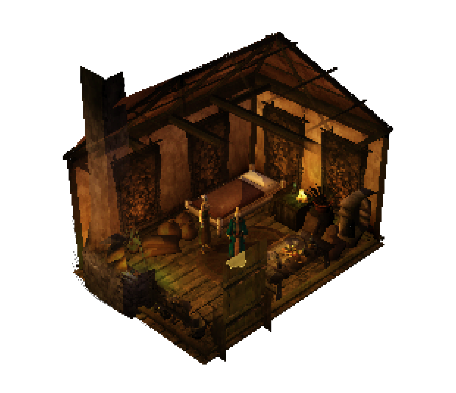

Isowind
=======

Morrowind, seen from above. Isowind is a modified [OpenMW](https://openmw.org) that plays The Elder Scrolls III:
Morrowind as a top-down, isometric game, with an optional pixel art look and online play with friends. It is the
whole of Morrowind (Tribunal and Bloodmoon too), your own copy of it. Isowind brings none of the game's files.

What it is
----------

* **A top-down camera.** You play from above: W is always up the screen, and you aim weapons and spells at the mouse
  cursor while your legs run the way you move. The mouse wheel zooms; F7 switches to Morrowind's third and first
  person views and back.
* **Seeing yourself through walls.** Walls, roofs and trees between you and the camera open up in a soft circle
  around you. Indoors, rooms are shown like a dollhouse: the near walls stop at waist height, and the ceiling and the
  floor above are left out.
* **Two looks.** *Pixel art* draws the world at low resolution, with chunky pixels, retro textures built from
  your own Morrowind files, banded light and hard shadows. *Normal* is Morrowind's usual graphics.
* **Made for a mouse or a controller.** The menus switch to suit whichever you are using. A controller gets its own
  menus, an on-screen keyboard, and quick keys on the bumpers.
* **Multiplayer.** A port of [TES3MP](https://tes3mp.com). Host a server from the launcher, as co-op (one shared
  world) or MMO (everyone has their own loot, quests and companions; enemies respawn; there are parties). A
  character can go between single-player and servers that allow it, and keeps everything gained in both.

How it works
------------

Isowind is a fork of OpenMW 0.51, with these parts:

* **The engine** (`apps/`, `components/`, `files/shaders/`) adds the top-down camera and the cutaway: shaders cut a
  circle out of whatever is in front of the player, and a second pass draws what was cut away, see-through, into
  that circle. It also adds the controller menus, the minimap that turns with the view, and TES3MP's multiplayer
  client.
* **The server** (`apps/openmw-mp`) is TES3MP's server, ported to this engine. Its Lua CoreScripts are in
  `isowind/server`, with Isowind's MMO rules, parties, private companions and portable characters added.
* **The Isowind mod** (`isowind/mod`, an `.omwscripts` content file) is OpenMW Lua: the controls, aiming, the
  view switch, the hover rings and the interface tweaks.
* **The looks** are two OpenMW profiles (`isowind/profiles/pixelart`, `normal`), each with its own `openmw.cfg`,
  `settings.cfg` and post-processing chain. The pixel art textures are made on your own computer, from your own
  Morrowind files, the first time you play that look (`isowind/tools/retro_textures.py`).
* **The launcher** (`Isowind.exe`, or `isowind.sh` on Linux) picks the look and the character, joins or hosts
  servers, and runs the engine with the right profile.

First time setup
----------------

**You need** Morrowind (the Game of the Year edition, from Steam or GOG) installed, and 64-bit Windows 10 or 11 or
64-bit Linux (the Steam Deck works too). Morrowind doesn't need to be run first, or have mods installed.

1. **Download** `Isowind.zip` from the [Releases](https://github.com/pw-tf/isowind/releases) page and unzip the whole folder somewhere you can
   write to, such as your Desktop or `D:\Games\Isowind` (not Program Files).
2. **Run `Isowind.exe`.** Windows may warn that the app is unrecognised (it isn't signed): click *More info*, then
   *Run anyway*.
3. **Press Play.** The first time, Isowind sees that OpenMW doesn't know where Morrowind is yet. It says so and
   opens the **OpenMW launcher**, which starts its **first-run wizard**:
   1. Choose your language and *Next*.
   2. Choose **Existing installation**. Morrowind is already installed, and the wizard only needs to find it.
   3. Pick your Morrowind in the list. Steam and GOG installs are usually found. If yours isn't listed, press
      *Browse...* and select `Morrowind.esm` in Morrowind's `Data Files` folder. On Steam that is usually
      `C:\Program Files (x86)\Steam\steamapps\common\Morrowind\Data Files`.
   4. On *Import Settings*, leave **Import Settings From Morrowind.ini** and **Import Add-on and Plugin
      Selection** ticked. The bitmap fonts option can stay off.
   5. *Finish*. In the OpenMW launcher, check on the **Data Files** page that `Morrowind.esm`, `Tribunal.esm` and
      `Bloodmoon.esm` are ticked, and tick any that aren't. If Morrowind has never been run, its `Morrowind.ini`
      may not list them yet. Then close the launcher. You don't need to press its own Play.
4. **Back in `Isowind.exe`, pick a look and press Play again.** The first time you play the pixel art look, Isowind
   builds its low-res textures from your Morrowind files. That takes a minute, and later starts are immediate.
5. Choose **New character**, or a character you already have, and play.

You can open the OpenMW launcher again at any time with the *OpenMW Launcher* button in `Isowind.exe`, to change
the Morrowind folder, mods or other options. Your saves are shared with any normal OpenMW you have.

**On Linux**, unpack the folder and run `./isowind.sh` from a terminal (or `./isowind.sh gui` for a launcher
window). It finds Morrowind in Steam's usual places and sets OpenMW up by itself. If it can't, run it as
`MORROWIND=/path/to/Morrowind ./isowind.sh`, giving the folder with `Data Files` in it. The pixel art look needs
Python 3.

**Playing online:** keep to Morrowind, Tribunal and Bloodmoon, with no other mods on in the OpenMW launcher, because
a server only lets in players whose game files match its own. Type the server's address under *Multiplayer* in
`Isowind.exe` and press *Join*, or press *Host a server* to run one. `README.txt` in the package covers hosting,
parties, portable characters and the controls in full.

**If something goes wrong:** the game's log is `profiles\pixelart\openmw.log` (or `profiles\normal\openmw.log`).
If saving fails, Windows Defender's *Controlled folder access* may be stopping `engine\openmw.exe` from writing to
Documents: allow it under Windows Security > Ransomware protection.

Building on Windows
-------------------

`isowind\windows\build.ps1` does the whole chain: CrabNet (the multiplayer networking), OpenMW's dependency
pack, the engine, `Isowind.exe` and the package.

You need, on the PATH:

* Git for Windows (its bash runs OpenMW's dependency script)
* CMake
* Visual Studio 2022 with the "Desktop development with C++" workload (2026 works, with `-VsVersion 2026`)
* Python 3 (python.org or the Microsoft Store), for the launcher's icon; Pillow is installed for you if it is missing
* Only for the bundled mods (see below): GitHub CLI, logged in (`winget install GitHub.cli`, then `gh auth login`)
  with access to this repository's private `bundled-mods` release
* 7-Zip, unless you are on Windows 11, whose own `tar.exe` extracts the dependency pack

Clone the repository into a folder of its own. Everything that isn't source goes beside the repository, in its
parent folder (`<root>`):

    <root>\
        <repository>\             this clone; the engine builds in MSVC2022_64 inside it
        crabnet\                  cloned and built by the script
        bundled-mods\             the third-party mods, if you have them (-WithMods fetches them)
        dist\Isowind\             the package, and dist\Isowind.zip beside it
        backups\                  test characters and saves, zipped before each packaging (the last five)

Then, in PowerShell, from the repository:

    Set-ExecutionPolicy -Scope CurrentUser RemoteSigned   # once, if PowerShell refuses to run scripts
    .\isowind\windows\build.ps1

The first run clones and builds CrabNet, downloads and unpacks the dependency pack, configures and builds the
engine (the final link with link-time optimisation alone takes ten to twenty minutes), compiles `Isowind.exe`
and packages. Later runs are incremental; after pulling changes:

    .\isowind\windows\build.ps1 -SkipDependencies

The engine ends up in `MSVC2022_64\Release`, `Isowind.exe` in `MSVC2022_64\launcher`, and the package in
`<root>\dist\Isowind` with `<root>\dist\Isowind.zip` beside it.

**The bundled mods.** By default the package is plain OpenMW with Isowind on top, as released here. The developers'
builds also carry a set of third-party mods (Rafael's Shader Pack, Weapon Sheathing, Questman, the Morrowind
Optimization Patch and others), which aren't in git and can't all be passed on. With access to the repository's
private `bundled-mods` release, fetch them once:

    .\isowind\windows\build.ps1 -SkipDependencies -WithMods

They go in `<root>\bundled-mods`, and every build after that packages them, with no switch needed. Packaging prints
which kind it is making. To make a release from a machine that has them, add `-NoMods`: that package goes in
`<root>\dist\nomods\Isowind` and `<root>\dist\nomods\Isowind.zip`, leaving your usual one alone.

Rebuilding keeps the test characters. The server's players, cells and world (`dist\Isowind\server\CoreScripts\data`)
and the host's `server\tes3mp-server.cfg` stay in the package folder; single-player saves are in
`Documents\My Games\OpenMW\saves`, which packaging never touches. `make_package.ps1` still zips both into
`<root>\backups\isowind-data-<date>-<time>.zip` first, and keeps the last five. The zip takes the server's data from
git (the empty folders and the default ban and plugin lists), so it never carries anyone's characters. To update a
copy elsewhere (Bottles, another PC), unzip the new `Isowind.zip` over the old folder rather than deleting the folder:
the players stay, and only the ban list goes back to empty.

| Switch                  | What it does                                                                                   |
|-------------------------|------------------------------------------------------------------------------------------------|
| `-SkipDependencies`     | Doesn't check or re-extract the dependency downloads. Use it on every build after the first.  |
| `-NoLto`                | No link-time optimisation: the final link takes a minute or two instead of ten to twenty. The game runs a little slower, so it is for working on the code, not for a release. |
| `-WithMods`             | Fetches the bundled mods into `<root>\bundled-mods` if they aren't there yet (needs the GitHub CLI and access to the private release). Builds after that have them anyway. |
| `-NoMods`               | Packages without the bundled mods even though `<root>\bundled-mods` is there, in `<root>\dist\nomods\Isowind` and `<root>\dist\nomods\Isowind.zip`: the public release. |
| `-SkipLauncher`         | Doesn't build `Isowind.exe`.                                                                   |
| `-SkipPackage`          | Doesn't run `make_package.ps1`.                                                                |
| `-Clean`                | A fresh build folder instead of keeping the existing one.                                      |
| `-Configuration Debug`  | `Release` (the default), `Debug` or `RelWithDebInfo`. Only a Release build is packaged.         |
| `-VsVersion 2026`       | Visual Studio 2026 instead of 2022; the build folder is then `MSVC2026_64`.                    |

The pieces, if you need one on its own:

* `make_package.ps1` assembles `<root>\dist\Isowind` from `MSVC2022_64\Release`, the mod, the bundled mods if any, the
  pixel art, profiles, server, licenses, `README.txt` and the GPL source patch against OpenMW's `openmw-0.51.0`
  tag (fetched if the clone lacks it), then zips it. It finds the repository from its own location.
* `make_icon.py` draws the icon; `Isowind.cs` compiles with .NET Framework 4's `csc.exe`, which comes with Windows,
  with `logo.png` (the launcher's logo) embedded as a resource.

If something goes wrong:

* **RakNet not found** at configure: the script lays CrabNet out as `<root>\crabnet\root` (`include\raknet`,
  `lib\RakNetLibStatic.lib`, `lib\RakNetLibStaticd.lib`) and sets `RAKNET_ROOT` to it, which
  `cmake\FindRakNet.cmake` honours; without a debug library the release one serves Debug too.
* **Windows Defender quarantines `openmw.exe`**: a fresh, unsigned binary can trip its heuristics. Restore it from
  Protection history, exclude `<root>` in Windows Security, and report the file to Microsoft as a false positive.
  The zip step fails while the file is quarantined.
* **No bundled mods** when you expected them: `gh auth login` and build with `-WithMods`, or put the mods in
  `<root>\bundled-mods` yourself.

Building on Linux
-----------------

The same steps as `.github/workflows/linux.yml`, which builds every push on Ubuntu 24.04. Everything that isn't
source goes in `build-deps/` and `build/` inside the clone (git ignores both).

**1. The libraries and tools.**

* Debian / Ubuntu: `sudo CI/install_debian_deps.sh gcc openmw-deps openmw-deps-dynamic`
* Arch: `sudo pacman -S --needed base-devel cmake git boost openscenegraph mygui sdl2-compat openal ffmpeg luajit lz4
  icu sqlite yaml-cpp recastnavigation unshield`

To play you also want Python 3 with Tk for the launcher window (`python3-tk` / `tk`) and Pillow for the pixel art
look (`python3-pil` / `python-pillow`; without it `isowind.sh` installs it into a private folder of its own). To
package: [linuxdeploy](https://github.com/linuxdeploy/linuxdeploy/releases) on the PATH (its AppImage; set
`APPIMAGE_EXTRACT_AND_RUN=1` if FUSE is missing), and, only for the bundled mods, the GitHub CLI logged in
(`gh auth login`) with access to their private release.

**2. CrabNet**, the multiplayer's networking, at the commit the Windows build uses:

    git clone https://github.com/TES3MP/CrabNet.git build-deps/crabnet
    git -C build-deps/crabnet checkout 19e6619
    sed -i '1i #include <cstdint>' build-deps/crabnet/Source/Utils/_FindFirst.h   # newer compilers want it
    cmake -S build-deps/crabnet -B build-deps/crabnet/build -DCMAKE_BUILD_TYPE=Release -DCRABNET_ENABLE_DLL=OFF \
        -DCRABNET_ENABLE_SAMPLES=OFF -DCMAKE_POSITION_INDEPENDENT_CODE=ON -DCMAKE_POLICY_VERSION_MINIMUM=3.5
    cmake --build build-deps/crabnet/build -j$(nproc)

**3. The engine** (the game, the server and the importer; not the editor, launcher or tools):

    cmake -S . -B build -DCMAKE_BUILD_TYPE=Release \
        -DBUILD_OPENCS=OFF -DBUILD_BSATOOL=OFF -DBUILD_ESMTOOL=OFF -DBUILD_ESSIMPORTER=OFF -DBUILD_NIFTEST=OFF \
        -DBUILD_NAVMESHTOOL=OFF -DBUILD_BULLETOBJECTTOOL=OFF -DBUILD_LAUNCHER=OFF -DBUILD_WIZARD=OFF \
        -DRakNet_INCLUDES=$PWD/build-deps/crabnet/include \
        -DRakNet_LIBRARY_RELEASE=$PWD/build-deps/crabnet/build/lib/libRakNetLibStatic.a \
        -DRakNet_LIBRARY_DEBUG=$PWD/build-deps/crabnet/build/lib/libRakNetLibStatic.a \
        <your system's options, below>
    cmake --build build -j$(nproc)

* Debian / Ubuntu: `-DUSE_SYSTEM_TINYXML=ON -DOPENMW_USE_SYSTEM_RECASTNAVIGATION=ON`
* Arch: `-DUSE_SYSTEM_TINYXML=OFF -DOPENMW_USE_SYSTEM_BULLET=OFF -DCMAKE_POLICY_VERSION_MINIMUM=3.5`. Arch has no
  TinyXML package, its Bullet is built for single precision where OpenMW wants double (so OpenMW builds its own),
  and CMake 4 wants the policy minimum for the older projects OpenMW pulls in.

`build/openmw` and `build/tes3mp-server` are the game and the server.

**4. The package**, laid out like the Windows one with `isowind.sh` in place of `Isowind.exe`:

    isowind/linux/package.sh build build-deps/Isowind

The bundled mods work as on Windows. By default the package goes without them, as released. With access to their
private release, fetch them once into `build-deps/bundled-mods`:

    isowind/linux/package.sh --with-mods build build-deps/Isowind

Every package after that has them, with no option needed. `--no-mods` leaves them out anyway, for a release; give it
a new folder (`build-deps/Isowind-release`) so your usual package and its test characters stay as they are.

**5. Play:** `build-deps/Isowind/isowind.sh` (or `isowind.sh gui` for the launcher window; `isowind.sh normal`,
`isowind.sh join ADDRESS` and `isowind.sh host` are the others, and `--controller` or `--no-controller` among the
arguments says whether the menus are made for a controller). The first time it looks for Morrowind in Steam's usual
places; otherwise run it as `MORROWIND=/path/to/Morrowind build-deps/Isowind/isowind.sh`, the folder with
`Data Files` and `Morrowind.ini`.

After changes, `cmake --build build -j$(nproc)` and `package.sh` again. Packaging into the same folder again keeps its
server data and `server/tes3mp-server.cfg`, as on Windows, after backing them and `~/.local/share/openmw/saves` up
into `~/.local/share/isowind/backups` (the last five); a release goes into a new folder, as the CI's does.
`package.sh` refuses a folder that has files in it and isn't a package. While working on the code, a package's
`engine/usr/bin/openmw` and `tes3mp-server` can be links to the ones in `build/`, so that a rebuild needs no
packaging; the server's `CoreScripts` are a copy, though, and must be refreshed after server script changes.

**Playing with others** takes the same engine source. The version players are matched on is a hash of the
engine's folders (`apps`, `components`, `files`, `extern`, `cmake`, `CMakeLists.txt`) as committed, taken each time
the build runs, so build again after committing or pulling engine changes, even when the code on disk was already
built. Isowind's mod and server scripts don't count.

Controls
--------

The defaults; Options > Controls rebinds them (and Options > Scripts > Isowind the view switch).

**Keyboard and mouse, in the game**

| Key                | What it does                                                                                    |
|--------------------|-------------------------------------------------------------------------------------------------|
| W A S D            | Move (W is always up the screen). Running is the default                                        |
| Shift              | Walk, while held                                                                                |
| Caps Lock          | Always run on or off                                                                            |
| Mouse              | Move the cursor. With a weapon or spell ready you aim at it while your legs run the way you move |
| Left click         | Attack / cast when ready, otherwise use what is under the cursor (doors, people, chests, items) |
| Right click        | Power attack: your weapon's strongest attack type                                               |
| E                  | Use what is under the cursor, or the nearest thing in front of you (indoors, a person or a door before the things lying between; never something on the floor below or above). A locked door or chest you have no key to: a go at picking it, with a lockpick carried |
| Space              | Jump. In water, hold it to swim up                                                              |
| Ctrl               | Sneak. In water, hold it to dive                                                                |
| F / R              | Ready weapon / ready magic                                                                      |
| [ / ]              | Previous / next weapon                                                                          |
| - / =              | Previous / next spell                                                                           |
| 1 - 0              | Quick keys, shown along the bottom of the screen                                                |
| F1                 | Morrowind's quick key menu                                                                      |
| Mouse wheel        | Zoom, within the view you are in                                                                |
| F7                 | Switch view: top-down, then third person, then first person                                     |
| Tab                | Inventory                                                                                       |
| J                  | Journal                                                                                         |
| T                  | Rest                                                                                            |
| Esc                | Menu                                                                                            |
| F5 / F9            | Quick save / quick load                                                                         |
| F11 / F12          | Hide the HUD / screenshot                                                                       |
| `` ` ``            | Console (the key left of 1)                                                                     |

**Keyboard and mouse, in the menus**

| Key                | What it does                                                                                    |
|--------------------|-------------------------------------------------------------------------------------------------|
| Q / E              | Previous / next page of the inventory screen (Map, Inventory, Magic, Stats), or tab in Options  |
| Z / C              | Previous / next tab inside a window: the kinds of item in the inventory or a shop, a chest's containers opened together, the local or world map, in Options the Video tab's (Detail Level, Water, Lights) and the Controls tab's mouse and keyboard / controller. With a chest or shop open, the window under the pointer |
| Click a tab        | That page. The HUD's bars, weapon, spell and minimap go to theirs too                           |
| 1 - 0              | Over an item, spell or enchanted item: puts it on that quick key                                |
| Drag onto a slot   | An item dragged onto a quick key slot along the bottom goes on that key                         |
| Right click a slot | Morrowind's quick key menu for that slot                                                        |
| Mouse wheel        | Over the minimap: zoom it                                                                       |
| Tab / Esc          | Close                                                                                           |

Q / E and Z / C type as usual in a text box.

**Controller, in the game** (it takes over as soon as a stick or button is used, the mouse as soon as it moves)

| Button             | What it does                                                                                    |
|--------------------|-------------------------------------------------------------------------------------------------|
| Left stick         | Move                                                                                            |
| Right stick        | Aim, or point at what X uses                                                                    |
| A                  | Jump. In water, hold it to swim up                                                              |
| B                  | Ready weapon                                                                                    |
| X                  | Use / talk: what the right stick points at, or else the nearest thing (indoors, a person or a door before the things lying between). A lock is picked, as with E |
| Y                  | Ready magic                                                                                     |
| Right trigger      | Attack / cast                                                                                   |
| Left trigger       | Power attack                                                                                    |
| Bumpers            | Previous / next quick key                                                                       |
| D-pad up / down    | Zoom (hold to keep going)                                                                       |
| D-pad right        | Quest log                                                                                       |
| D-pad left         | Nothing for now                                                                                 |
| Start              | Menu                                                                                            |
| Back               | Inventory (hold: journal)                                                                       |
| Left stick in      | Sneak. In water, hold it in to dive                                                             |
| Right stick in     | Rest                                                                                            |

**Controller, in the menus**

| Button             | What it does                                                                                    |
|--------------------|-------------------------------------------------------------------------------------------------|
| D-pad, A           | Choose                                                                                          |
| B                  | Back                                                                                            |
| Bumpers            | The inventory screen's pages; with a chest or shop open, between its window and yours; Options' tabs |
| Triggers           | The tabs inside a window, and in Options inside a tab (Video's; Controls' mouse and keyboard / controller) |
| Right stick in     | An item's info                                                                                  |
| Y                  | In the inventory and magic pages: puts the item or spell on a quick key                         |
| X                  | On a text box (moved onto with the D-pad): a keyboard on the screen. Start or Back puts it away |

Whether the menus are made for a controller is decided as the game starts: `Isowind.exe`'s **Controller** tick box,
or on Linux what is plugged in, which `--controller` or `--no-controller` overrides (a controller that comes with a
stream, as Moonlight's does, wants `--controller`).

~ This mod was made in assistance with AI. ~
